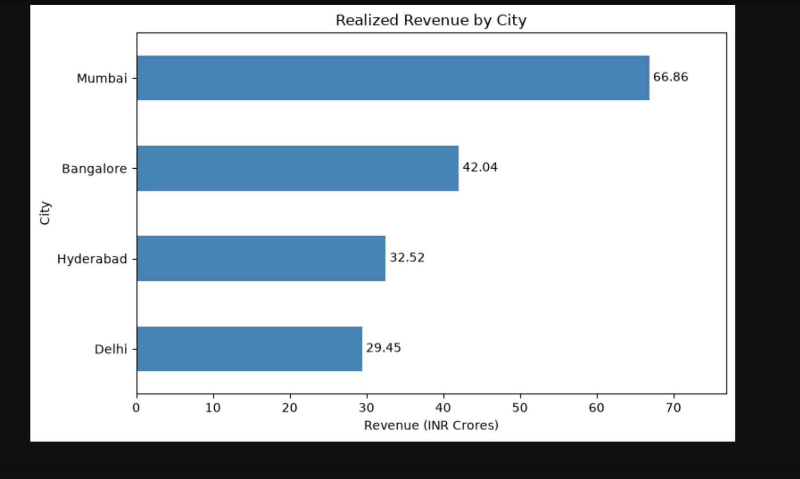

🏨 AtliQ Hospitality — Business Performance Analysis Using Python
Python · Pandas · Matplotlib · Exploratory Data Analysis · Business Analytics
Project Overview
This project explores hotel booking performance across Mumbai, Delhi, Hyderabad and Bangalore from May to July 2022. The objective is to turn raw booking data into actionable insights on room utilization, realized revenue, booking channels and cancellations.
The analysis builds on a guided Codebasics Data Analytics Bootcamp project, with additional data validation, visualizations, business questions and recommendations.
Business Objectives
Evaluate occupancy across room classes and cities.
Identify weekday and weekend demand patterns.
Analyse city-level and monthly realized revenue.
Compare booking channel contribution and cancellation rates.
Estimate potential unrealized booking revenue and identify opportunities for further investigation.
Key Performance Indicators
Metric	Result
Total realized revenue	₹170.88 crore
Highest revenue city	Mumbai — ₹66.86 crore
Highest occupancy city	Delhi — 60.52%
Weekend occupancy	73.58%
Weekday occupancy	51.34%
Highest occupancy room class	Presidential — 59.22%
Highest revenue month	May 2022 — ₹58.19 crore
Potential unrealized booking revenue	₹30.08 crore*
The last metric includes unverified extreme revenue values and is not a confirmed financial loss or recoverable revenue estimate.
Tools & Skills
Tool	Application
Python	Data analysis and calculations
Pandas	Data cleaning, merging, grouping and aggregation
Matplotlib	Business data visualization
Jupyter Notebook	Reproducible analysis and documentation
Dataset Overview
File	Description
`fact_bookings.csv`	Booking-level revenue, status and platform data
`fact_aggregated_bookings.csv`	Successful bookings and room capacity
`dim_hotels.csv`	Hotel properties, categories and cities
`dim_rooms.csv`	Room category and class mapping
`dim_date.csv`	Calendar and day-type information
`new_data_august.csv`	Seven additional sample records, analysed separately
Analysis Workflow
Import libraries and load datasets.
Explore data structure, missing values and booking records.
Investigate invalid guest counts, revenue outliers and capacity issues.
Merge relevant datasets and validate join relationships.
Calculate occupancy, realized revenue, channel contribution and cancellation rates.
Visualize results and develop business recommendations.
Metric Definitions
Occupancy (%) = Total successful bookings / Total valid available capacity × 100.
Revenue contribution (%) = Channel realized revenue / Total realized revenue × 100.
Cancellation rate (%) = Cancelled bookings / Total bookings × 100.
Potential unrealized booking revenue = Generated revenue minus realized revenue for cancelled and no-show bookings.
Analysis & Key Insights
1. Occupancy Performance by City

Delhi leads at 60.52%, while Bangalore records the lowest occupancy at 55.76%. Investigate local demand, pricing and competition before introducing targeted promotions.
2. Weekday vs Weekend Occupancy

Weekend occupancy exceeds weekday occupancy by 22.24 percentage points. Test corporate packages and weekday promotions while monitoring realized revenue alongside occupancy.
3. Realized Revenue by City

Mumbai generates ₹66.86 crore, approximately 39.1% of total realized revenue. Bangalore contributes ₹42.04 crore. Compare capacity, demand and pricing before making resource allocation decisions.
4. Monthly Realized Revenue Trend

Month	Realized revenue
May 2022	₹58.19 crore
June 2022	₹55.39 crore
July 2022	₹57.29 crore
Revenue declined in June before partially recovering in July. Investigate booking volumes and pricing changes; three months of data are insufficient to establish annual seasonality.
5. Revenue Contribution by Booking Platform

The Others category contributes 40.93% of realized revenue, followed by MakeYourTrip at 19.95%. Direct Offline contributes 5.06%. Evaluate channel commissions and cancellation behaviour before changing the distribution strategy.
6. Room Class Performance
Presidential rooms lead occupancy at 59.22%, followed by Standard (57.84%), Elite (57.61%) and Premium (57.58%). The narrow spread suggests that occupancy alone is insufficient for inventory decisions.
7. Booking Cancellations & Revenue Realization
Cancellation rates range from 24.30% to 24.99% across platforms, a difference of just 0.69 percentage points. Investigate common cancellation drivers rather than assuming a single channel is responsible.
The recorded generated-versus-realized revenue difference for cancellations and no-shows is ₹30.08 crore. Verify suspicious revenue records before using this figure in business decisions.
Strategic Recommendations
Priority	Recommended action	Measure of success
Weekday demand	Test corporate packages and targeted offers	Weekday occupancy and realized revenue
City performance	Investigate local pricing, capacity and demand	City occupancy and revenue
Channel efficiency	Compare commission costs and cancellation behaviour	Net channel revenue and cancellation rate
Revenue realization	Validate outliers and test booking reminders	Cancellation rate and validated revenue realization
These are proposed actions, not measured business outcomes.
Data Quality & Limitations
Aggregated occupancy is capacity-weighted rather than a simple average of row-level percentages.
Successful bookings are a proxy for occupancy, not confirmed occupied room nights.
Invalid guest counts are treated as missing; booking revenue is retained.
Missing ratings are not replaced with zero.
Extreme revenue values require verification; unrealized booking revenue is not necessarily actual loss because rooms may be resold.
Seven August sample records are excluded from May–July performance comparisons.
The three-month analysis cannot establish annual seasonality.
Repository Structure
```text
AtliQ-Hospitality-Python-Analysis/
├── datasets/
├── images/
├── AtliQ_Hospitality_Analysis.ipynb.ipynb
├── requirements.txt
└── README.md
```
How to Run the Project
Clone the repository and install the dependencies:
```bash
git clone https://github.com/arpan-data/AtliQ-Hospitality-Python-Analysis.git
cd AtliQ-Hospitality-Python-Analysis
pip install -r requirements.txt
jupyter notebook
```
Open the main hospitality analysis notebook from the repository root. Restart the kernel and run all cells in sequence. Keep the CSV files in the `datasets` folder. If Jupyter is not installed, run `pip install notebook` first.
Conclusion
This project demonstrates how Python can be used to clean, validate and analyse business data, communicate performance patterns through visualizations, and translate findings into practical recommendations. The main opportunities identified are improving weekday demand, evaluating city and booking channel performance, and strengthening revenue data quality.
Acknowledgements
Dataset and original guided exercise: Codebasics Data Analytics Bootcamp. This portfolio project extends the course exercise for educational purposes. Dataset ownership remains with its respective owner.
Author
Arpan Adhikary — Aspiring Data Analyst
GitHub Profile
