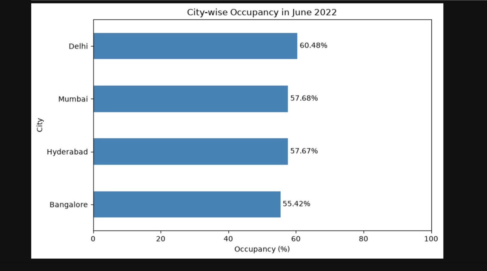
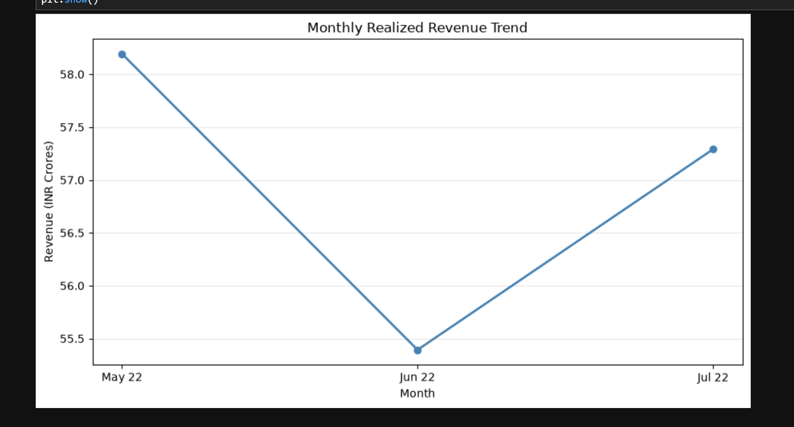
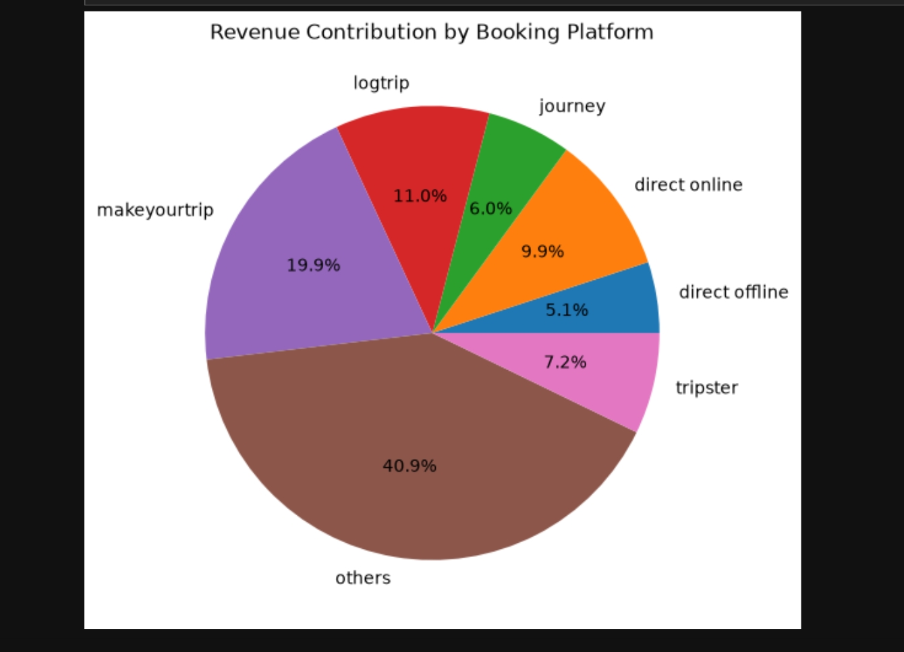

# 🏨 AtliQ Hospitality – Business Performance Analysis Using Python

**Python | Pandas | Matplotlib | Exploratory Data Analysis | Business Analytics**

## 📌 Project Overview

This project analyses the business performance of AtliQ Hospitality across four major Indian cities — Mumbai, Delhi, Bangalore and Hyderabad — using Python.

The analysis focuses on hotel booking data from May to July 2022 to evaluate occupancy, revenue performance, booking platform contribution and cancellation patterns.

The primary objective is to transform raw hospitality data into meaningful business insights and provide actionable recommendations to support management decision-making.

## 🎯 Business Objectives

- Evaluate occupancy across room classes and cities.
- Compare weekday and weekend occupancy performance.
- Identify major revenue-generating markets.
- Analyse monthly revenue trends and growth.
- Evaluate revenue contribution across booking platforms.
- Identify customer cancellation patterns.
- Estimate potential unrealized booking revenue.
- Provide data-driven business recommendations.

## 🛠️ Tools & Technologies

| Tool | Application |
|---|---|
| Python | Data analysis and processing |
| Pandas | Data cleaning, manipulation and aggregation |
| Matplotlib | Data visualization |
| Jupyter Notebook | Exploratory analysis and documentation |
| GitHub | Project documentation and version control |

## 📂 Dataset Description

The project uses six CSV files containing hotel booking transactions, room capacity and supporting business information.

| Dataset | Description |
|---|---|
| `fact_bookings.csv` | Individual bookings, revenue, booking status and platforms |
| `fact_aggregated_bookings.csv` | Aggregated bookings and room capacity |
| `dim_hotels.csv` | Hotel properties, categories and cities |
| `dim_rooms.csv` | Room categories and room class information |
| `dim_date.csv` | Calendar information, months and day types |
| `new_data_august.csv` | Additional August sample records |

**Primary analysis period:** May–July 2022

**Data source:** Codebasics Data Analytics Bootcamp.

## 🔄 Project Workflow

Data Collection → Data Exploration → Data Cleaning → Data Validation → Data Transformation → Exploratory Data Analysis → Visualization → Business Insights → Recommendations

### Data Cleaning & Preparation

- Investigated invalid guest counts and missing values.
- Identified unusual revenue values using descriptive statistics.
- Handled invalid room capacity and booking records.
- Standardized date formats and inconsistent category labels.
- Combined fact and dimension tables using Pandas.
- Validated booking-level merges for duplicate records, missing city values and row-count consistency.
- Kept incomplete August records separate from the primary analysis.

### Analytical Methodology

Capacity-weighted occupancy was calculated using total successful bookings divided by total available capacity, rather than simply averaging individual occupancy percentages.

This approach ensures that properties with different room capacities are appropriately represented.

## 📊 Key Business Metrics

| Metric | Result |
|---|---:|
| Total Realized Revenue | ₹170.88 Cr |
| Highest Revenue City | Mumbai |
| Mumbai Revenue | ₹66.86 Cr |
| Highest Occupancy City | Delhi – 60.52% |
| Weekend Occupancy | 73.58% |
| Weekday Occupancy | 51.34% |
| Highest Occupancy Room Class | Presidential – 59.22% |
| Highest Revenue Month | May 2022 |
| Potential Unrealized Booking Revenue | ₹30.08 Cr* |

*The potential unrealized revenue estimate is subject to data quality limitations and does not represent confirmed financial loss.*

## 📈 Analysis & Key Insights

### 1. Occupancy Performance by City



- Delhi recorded the highest occupancy at 60.52%.
- Bangalore recorded the lowest occupancy at 55.76%.
- The results highlight opportunities to investigate city-specific demand, pricing and competition.

### 2. Weekday vs Weekend Occupancy


- Weekend occupancy reached 73.58%.
- Weekday occupancy stood at 51.34%.
- The gap of 22.24 percentage points highlights an opportunity to improve weekday demand through targeted business strategies.

### 3. Revenue Performance by City


- Mumbai was the largest revenue-generating market, contributing ₹66.86 crore.
- Bangalore ranked second with ₹42.04 crore.
- Delhi recorded the lowest realized revenue at ₹29.45 crore despite having the highest occupancy.

This highlights the importance of evaluating room capacity and pricing alongside occupancy.

### 4. Monthly Revenue Trend



| Month | Realized Revenue | MoM Growth |
|---|---:|---:|
| May 2022 | ₹58.19 Cr | — |
| June 2022 | ₹55.39 Cr | −4.81% |
| July 2022 | ₹57.29 Cr | +3.43% |

Revenue declined in June before partially recovering in July. Further investigation into booking demand, pricing and capacity would help explain these fluctuations.

### 5. Booking Platform Performance



- The Others booking channel contributed 40.93% of total realized revenue.
- Direct Offline contributed the smallest share at 5.06%.
- Cancellation rates across platforms ranged from 24.30% to 24.99%, indicating relatively consistent cancellation patterns.

### 6. Potential Unrealized Booking Revenue

- The recorded difference between generated and realized revenue for cancellations and no-shows amounted to ₹30.08 crore.
- Cancellations accounted for the recorded revenue gap.
- Unusual generated-revenue values require verification before this estimate can support financial decisions.

## 💡 Strategic Business Recommendations

| Business Opportunity | Recommended Action |
|---|---|
| Low weekday occupancy | Test corporate packages, weekday promotions and extended-stay offers |
| Lower occupancy in Bangalore | Investigate local demand, pricing and competition |
| Revenue concentration | Maintain performance in major markets while evaluating growth opportunities in other cities |
| Booking channel performance | Compare revenue contribution, cancellation behaviour and commission costs |
| High cancellation rates | Review cancellation policies and test booking confirmation reminders |
| Revenue realization | Validate unusual revenue records and investigate cancellation-related revenue gaps |

## 🧠 Skills Demonstrated

- Exploratory Data Analysis (EDA)
- Data Cleaning and Validation
- Data Transformation
- Data Merging and Table Relationships
- Grouping and Aggregation
- Date and Time Manipulation
- Statistical Outlier Investigation
- Business KPI Calculation
- Data Visualization
- Business Understanding
- Data Storytelling

## 📁 Repository Structure

```text
AtliQ-Hospitality-Python-Analysis/
│
├── datasets/
├── images/
├── AtliQ_Hospitality_Analysis.ipynb
├── requirements.txt
└── README.md
```

## 🚀 How to Run the Project

1. Download or clone this repository.
2. Ensure Python is installed on your system.
3. Install the required libraries:

```bash
pip install -r requirements.txt
```

4. Ensure the required CSV files are available in the `datasets` folder.
5. Launch Jupyter Notebook:

```bash
jupyter notebook
```

6. Open `AtliQ_Hospitality_Analysis.ipynb`.
7. Run all cells sequentially to reproduce the analysis.

## ⚠️ Analysis Limitations

- The primary analysis covers only three months of hotel operations.
- August contains incomplete sample records and is excluded from the main performance analysis.
- Occupancy represents successful bookings relative to capacity, not confirmed occupied room nights.
- Extreme revenue values require further verification.
- Potential unrealized booking revenue should not be interpreted as confirmed financial loss.
- Annual seasonality cannot be established using three months of data.

## 📝 Conclusion

This project demonstrates how Python can be used to transform raw hospitality data into actionable business insights.

The analysis identified opportunities to improve weekday occupancy, evaluate city-level performance, understand booking channel contribution and improve revenue realization.

Through data cleaning, exploratory analysis, visualization and business interpretation, this project demonstrates the practical application of data analytics to business decision-making.

## 🙏 Acknowledgements

This project is based on the hospitality dataset and guided learning exercise provided by Codebasics as part of its Data Analytics Bootcamp.

The analysis builds upon the guided exercise through additional data validation, capacity-weighted occupancy calculations, business insights and recommendations.

---

**If you found this project useful, feel free to explore the notebook and share your feedback.**
