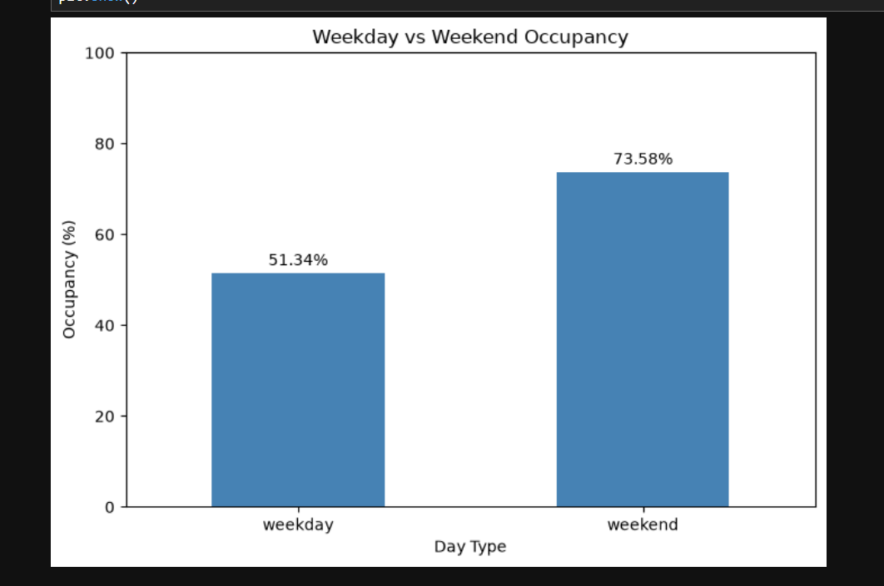

# 🏨 AtliQ Hospitality — Business Performance Analysis Using Python


**Exploratory Data Analysis | Business Analytics | Data Visualization | Hospitality Analytics**

---

## 📌 Project Overview

This project analyses the business performance of AtliQ Hospitality across four major Indian cities — Mumbai, Delhi, Hyderabad and Bangalore — using Python.

The analysis focuses on hotel booking data from May to July 2022 to evaluate occupancy performance, revenue trends, booking platform contribution and cancellation patterns.

The primary objective is to transform raw hospitality data into meaningful business insights and provide actionable recommendations to support data-driven decision-making.

This project builds on a guided Codebasics Data Analytics Bootcamp exercise, with additional data validation, analytical questions, visualizations and business recommendations.

---

## 🎯 Business Objectives

- Evaluate occupancy performance across room classes and cities.
- Compare weekday and weekend occupancy.
- Identify major revenue-generating markets.
- Analyse monthly revenue trends.
- Evaluate revenue contribution across booking platforms.
- Investigate booking cancellation patterns.
- Estimate potential unrealized booking revenue.
- Provide actionable business recommendations.

---

## 📊 Key Performance Indicators

| Business Metric | Result |
|---|---:|
| Total Realized Revenue | Approximately ₹170.9 Cr |
| Highest Revenue City | Mumbai — ₹66.86 Cr |
| Highest Occupancy City | Delhi — 60.52% |
| Weekend Occupancy | 73.58% |
| Weekday Occupancy | 51.34% |
| Highest Occupancy Room Class | Presidential — 59.22% |
| Highest Revenue Month | May 2022 |
| Potential Unrealized Booking Revenue | ₹30.08 Cr* |

*The potential unrealized revenue estimate is subject to data quality limitations and does not represent a confirmed financial loss.*

---

## 🛠️ Tools & Technologies

| Tool | Purpose |
|---|---|
| Python | Data analysis and business calculations |
| Pandas | Data cleaning, manipulation and aggregation |
| Matplotlib | Data visualization |
| Jupyter Notebook | Exploratory analysis and documentation |
| GitHub | Version control and portfolio presentation |

---

## 📂 Dataset Overview

The project uses six CSV files containing hotel booking transactions, property information, room categories and calendar details.

| Dataset | Description |
|---|---|
| `fact_bookings.csv` | Booking transactions, revenue, booking status and platforms |
| `fact_aggregated_bookings.csv` | Successful bookings and available room capacity |
| `dim_hotels.csv` | Hotel properties, categories and cities |
| `dim_rooms.csv` | Room category and room class mapping |
| `dim_date.csv` | Calendar and day-type information |
| `new_data_august.csv` | Additional sample booking records |

The primary analysis covers May to July 2022. The August dataset contains seven sample records and is explored separately.

---

## 🔄 Project Workflow

```text
Data Collection
      ↓
Data Exploration
      ↓
Data Cleaning & Validation
      ↓
Data Transformation
      ↓
Dataset Integration
      ↓
Exploratory Data Analysis
      ↓
Data Visualization
      ↓
Business Insights
      ↓
Strategic Recommendations
```

### Data Cleaning & Preparation

- Investigated missing values and duplicate records.
- Identified invalid guest counts.
- Examined extreme revenue values.
- Investigated missing and inconsistent room capacity.
- Validated dataset merge relationships.
- Converted date columns into appropriate formats.
- Calculated capacity-weighted occupancy.
- Prepared aggregated datasets for business analysis.

---

## 📐 Key Metric Definitions

### Occupancy Rate (%)

Total Successful Bookings / Total Valid Available Capacity × 100

### Revenue Contribution (%)

Booking Platform Realized Revenue / Total Realized Revenue × 100

### Cancellation Rate (%)

Cancelled Bookings / Total Bookings × 100

### Potential Unrealized Booking Revenue

Generated Revenue − Realized Revenue for cancelled and no-show bookings.

---

## 📈 Analysis & Key Business Insights

### 1. Occupancy Performance by City


**Key Findings**

- Delhi recorded the highest occupancy at **60.52%**.
- Bangalore recorded the lowest occupancy at **55.76%**.
- Occupancy performance varies across different markets.

**Business Recommendation**

Investigate city-specific demand, pricing, available capacity and competition to identify opportunities for improving occupancy performance.

---

### 2. Weekday vs Weekend Occupancy



**Key Findings**

- Weekend occupancy reached **73.58%**.
- Weekday occupancy stood at **51.34%**.
- Weekend occupancy exceeded weekday occupancy by **22.24 percentage points**.
- Lower weekday occupancy indicates an opportunity to improve room utilization.

**Business Recommendation**

Test corporate booking packages, weekday discounts and extended-stay offers to improve weekday demand.

Monitor both occupancy and realized revenue to evaluate the effectiveness of these initiatives.

---

### 3. Realized Revenue by City


| City | Realized Revenue |
|---|---:|
| Mumbai | ₹66.86 Cr |
| Bangalore | ₹42.04 Cr |
| Hyderabad | ₹32.52 Cr |
| Delhi | ₹29.45 Cr |

**Key Findings**

- Mumbai is the largest revenue-generating market.
- Mumbai contributes approximately **39.1%** of total realized revenue.
- Mumbai and Bangalore together contribute approximately **64%** of total realized revenue.
- Revenue is concentrated in the two leading markets.

**Business Recommendation**

Investigate pricing, room capacity and customer demand across markets before making resource allocation decisions.

---

### 4. Monthly Realized Revenue Trend


**Key Findings**

- May 2022 recorded the highest realized revenue.
- Revenue declined in June before partially recovering in July.
- The analysis highlights short-term fluctuations in monthly business performance.

**Business Recommendation**

Investigate changes in booking volumes, pricing and customer demand to understand monthly revenue fluctuations.

Additional historical data would be required to identify reliable seasonal patterns.

---

### 5. Revenue Contribution by Booking Platform


| Booking Platform | Revenue Contribution |
|---|---:|
| Others | 40.93% |
| MakeYourTrip | 19.95% |
| Logtrip | 10.98% |
| Direct Online | 9.89% |
| Tripster | 7.20% |
| Journey | 6.00% |
| Direct Offline | 5.06% |

**Key Findings**

- The Others category contributes the largest revenue share at **40.93%**.
- MakeYourTrip is the largest individually identified booking platform.
- Direct Offline contributes the smallest revenue share at **5.06%**.

**Business Recommendation**

Evaluate booking platform commissions, cancellation behaviour and net revenue before making changes to the distribution strategy.

---

### 6. Occupancy Performance by Room Class

| Room Class | Occupancy Rate |
|---|---:|
| Presidential | 59.22% |
| Standard | 57.84% |
| Elite | 57.61% |
| Premium | 57.58% |

**Key Findings**

- Presidential rooms recorded the highest occupancy.
- Premium rooms recorded the lowest occupancy.
- Occupancy differences across room classes are relatively small.

**Business Recommendation**

Evaluate room pricing, revenue contribution and customer preferences alongside occupancy before making room inventory decisions.

---

### 7. Booking Cancellation Analysis

**Key Findings**

- Cancellation rates range from approximately **24.30% to 24.99%** across booking platforms.
- Approximately one in four bookings is cancelled.
- Cancellation rates are relatively consistent across platforms.
- The narrow variation suggests that cancellation behaviour may not be limited to a particular booking platform.

**Business Recommendation**

Investigate common cancellation drivers, including booking lead time, cancellation policies and customer behaviour.

Test booking confirmation reminders and evaluate their impact on cancellation rates.

---

### 8. Potential Unrealized Booking Revenue

The recorded difference between generated and realized revenue for cancelled and no-show bookings is approximately **₹30.08 crore**.

This highlights an opportunity to investigate booking behaviour and revenue realization.

However, extreme revenue records require further verification before this estimate can support financial decisions.

The estimate should not be interpreted as confirmed financial loss, since cancelled rooms may be resold and cancellation charges may be retained.

---

## 💡 Strategic Business Recommendations

| Business Area | Recommended Action | Success Metric |
|---|---|---|
| Weekday Demand | Test corporate packages and targeted promotions | Weekday occupancy and revenue |
| City Performance | Investigate local demand, pricing and capacity | City occupancy and revenue |
| Booking Channels | Compare platform commissions and cancellations | Net channel revenue |
| Room Performance | Evaluate room pricing and customer preferences | Room-class revenue and occupancy |
| Cancellations | Test booking confirmation reminders | Cancellation rate |
| Revenue Realization | Investigate and validate extreme revenue records | Validated revenue realization |

These recommendations represent proposed business actions rather than measured business outcomes.

---

## ⚠️ Analysis Limitations

- The primary analysis covers only three months of data.
- Successful bookings are used as a proxy for occupancy rather than confirmed occupied room nights.
- Missing customer ratings are not treated as zero ratings.
- Invalid guest counts and extreme revenue values require careful interpretation.
- Potential unrealized booking revenue does not necessarily represent actual financial loss.
- Booking platform commission information is unavailable.
- The August dataset contains only seven sample records and is excluded from the primary analysis.
- Additional historical data is required to establish annual seasonality.

---

## 📁 Repository Structure

```text
AtliQ-Hospitality-Python-Analysis/
│
├── datasets/
│   ├── dim_date.csv
│   ├── dim_hotels.csv
│   ├── dim_rooms.csv
│   ├── fact_bookings.csv
│   ├── fact_aggregated_bookings.csv
│   └── new_data_august.csv
│
├── images/
│   ├── occupancy_by_city.png.jpeg
│   ├── weekday_vs_weekend.png.png
│   ├── revenue_by_city.png.jpeg
│   ├── monthly_revenue_trend.png.jpeg
│   └── revenue_by_platform.png.jpeg
│
├── AtliQ_Hospitality_Analysis.ipynb.ipynb
├── requirements.txt
└── README.md
```

---

## 🚀 How to Run the Project

### Step 1: Clone the repository

```bash
git clone https://github.com/arpan-data/AtliQ-Hospitality-Python-Analysis.git
```

### Step 2: Navigate to the project directory

```bash
cd AtliQ-Hospitality-Python-Analysis
```

### Step 3: Install the required dependencies

```bash
pip install -r requirements.txt
```

### Step 4: Launch Jupyter Notebook

```bash
jupyter notebook
```

If Jupyter Notebook is not installed:

```bash
pip install notebook
```

### Step 5: Run the analysis

- Open the main hospitality analysis notebook from the repository root.
- Restart the kernel.
- Run all cells sequentially.
- Explore the visualizations and business insights.

Ensure that the datasets folder remains inside the main project directory.

---

## 🧠 Skills Demonstrated

### Technical Skills

- Python for Data Analytics
- Pandas DataFrame Operations
- Exploratory Data Analysis (EDA)
- Data Cleaning and Validation
- Data Transformation
- Missing Value Handling
- Outlier Investigation
- Dataset Merging
- GroupBy and Aggregation
- Date and Time Analysis
- Data Visualization

### Business & Analytical Skills

- Business KPI Calculation
- Revenue Analysis
- Occupancy Analysis
- Booking Channel Analysis
- Business Problem-Solving
- Data Interpretation
- Data Storytelling
- Strategic Recommendations

---

## 📝 Conclusion

This project demonstrates how Python can be used to transform raw hospitality data into meaningful business insights.

The analysis identifies opportunities to improve weekday occupancy, evaluate booking channel performance, understand revenue fluctuations and investigate booking cancellations.

One of the most significant findings is the gap between weekday and weekend occupancy, highlighting an opportunity to improve weekday demand through targeted business strategies.

Through data cleaning, validation, exploratory analysis and visualization, this project connects technical analytical skills with practical business decision-making.

---

## 🙏 Acknowledgements

The dataset and original guided exercise were provided through the **Codebasics Data Analytics Bootcamp**.

This project extends the original exercise with additional analytical questions, data validation, visualizations, business insights and recommendations for educational and portfolio purposes.

Dataset ownership remains with its respective owner.

---

## 👨‍💻 Author

### Arpan Das

**Data Analyst | B.Tech in Mechanical Engineering**

Passionate about transforming complex data into meaningful business insights and supporting data-driven decision-making.

Interested in solving real-world business problems through data analysis, visualization and analytical thinking.

**Technical Skills:** Python | SQL | Power BI | Excel | Data Visualization | Business Analytics

### 🤝 Connect with Me

[](https://www.linkedin.com/in/arpan-das-785799379)

[](https://github.com/arpan-data)

---

⭐ If you find this project useful, feel free to star the repository.
